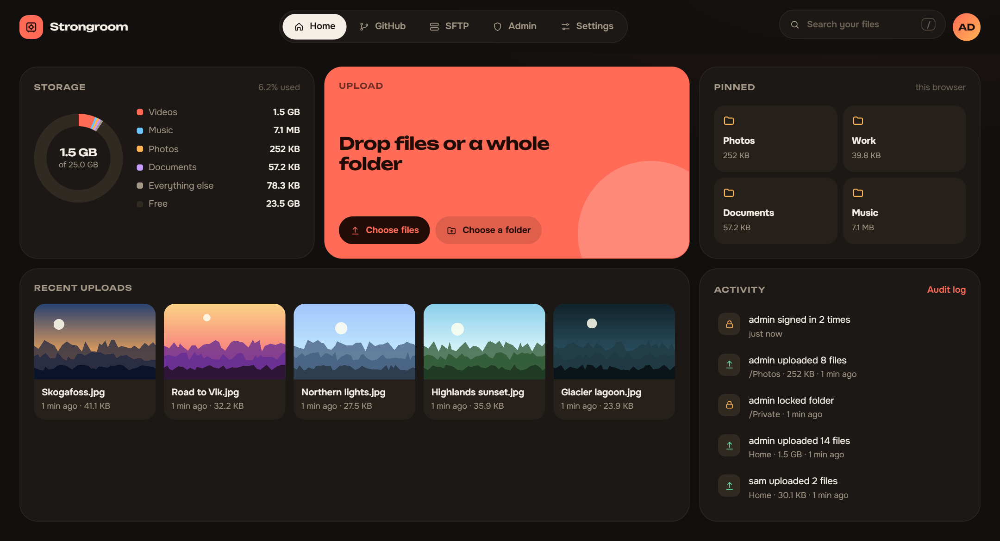
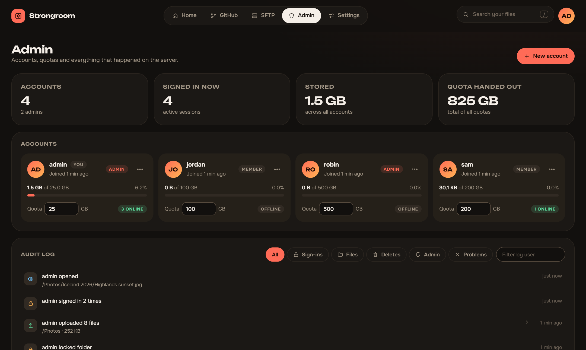
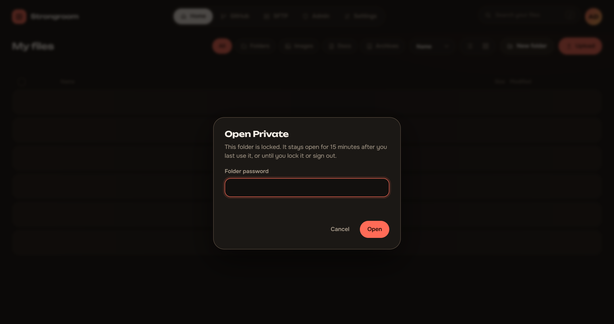

<div align="center">


# Strongroom

A self-hosted file server with a web interface and built-in SFTP.<br>
One Node.js process, one SQLite database, your files as plain files on disk.

[](https://github.com/Findiepman/Strongroom/actions/workflows/ci.yml)
[](https://github.com/Findiepman/Strongroom/releases)
[](LICENSE)


</div>

Strongroom is for a household or a small team that wants its files on its own
machine instead of Google Drive or OneDrive. Everyone gets an account with a
storage quota, uses the browser for everyday work, and an SFTP client or sync
tool for bulk transfers. It runs on anything from a Raspberry Pi to a VPS, and
because files are stored as ordinary files, your existing backup tools keep working.

## Quick start

```bash
mkdir strongroom && cd strongroom
curl -O https://raw.githubusercontent.com/Findiepman/Strongroom/main/docker-compose.yml
docker compose up -d
docker compose logs strongroom | grep Password
```

Open <http://localhost:8080> and sign in as `admin` with the password from the
logs, then change it under **Settings**. Files, accounts and keys live in the
`strongroom-data` volume and survive updates. SFTP listens on port 2222.

> [!IMPORTANT]
> The sign-in cookie is HTTPS-only. Chrome, Edge and Firefox make an exception
> for `http://localhost` (Safari does not), but from another device on plain
> `http://192.168.x.x:8080` the sign-in won't stick. For a quick test on your
> own network, uncomment `COOKIE_SECURE: "false"` in `docker-compose.yml`. For
> real use, put Strongroom behind HTTPS ([Cloudflare Tunnel or a reverse proxy](docs/deployment.md)).

- **Keep files on a specific disk:** replace `strongroom-data:/data` with a host
  folder, e.g. `/mnt/storage/strongroom:/data`. The container sets its ownership on start.
- **Update:** `docker compose pull && docker compose up -d`
- Images are published for `linux/amd64` and `linux/arm64`. The container runs
  as an unprivileged user and has a health check. To build it yourself:
  `docker build -t ghcr.io/findiepman/strongroom .`

## Features

- Web file manager: drag and drop files or whole folders, progress tray, list
  or grid view with thumbnails, filters, sorting, search across all folders,
  in-browser preview of images, PDFs and text, and folder downloads as ZIP.
- Dashboard with storage per folder, pinned folders, recent uploads and activity.
- Multiple accounts with admin and member roles, a quota per account, force
  sign-out, and an audit log of sign-ins, uploads, downloads and deletes.
- Built-in SFTP with the same login, folder, upload checks and quota as the web
  app. Works with FileZilla, WinSCP, Cyberduck and `sftp`, and as a two-way sync
  target ([rclone bisync on Windows](docs/rclone-bisync-windows.md)).
- Folder passwords: lock any folder with a second password on top of the sign-in.
- GitHub puller: paste a public repository URL and the server clones it, or
  fast-forwards it on the next pull, with a live log. Handy for keeping copies
  of repositories on your own storage.

**Not supported (yet):** public share links, two-factor sign-in or SSO, WebDAV,
mobile apps, and encryption at rest.

## Screenshots

<table>
  <tr>
    <td width="50%"></td>
    <td width="50%"></td>
  </tr>
  <tr>
    <td></td>
    <td></td>
  </tr>
  <tr>
    <td></td>
    <td></td>
  </tr>
</table>

## Install without Docker

Requires Node.js 20+ and `git` (for the GitHub puller). Linux is recommended for
production; Windows and macOS work for development.

```bash
git clone https://github.com/Findiepman/Strongroom.git && cd Strongroom
npm install
npm start
```

Without a `.env` file Strongroom runs entirely out of `./data/` and generates its
own session secret. On first start it creates the admin account and prints a
random password **once**. For a real install, copy `.env.example` to `.env`,
set `NODE_ENV=production` and a `JWT_SECRET`:

```bash
node -e "console.log(require('crypto').randomBytes(48).toString('base64url'))"
```

Running it as a systemd service, on a dedicated drive or with files on a NAS is
covered in the [deployment guides](docs/deployment.md).

## Configuration

All settings are environment variables, read from `.env` or from the
`environment:` block in `docker-compose.yml`.

| Variable | Default | Meaning |
|---|---|---|
| `PORT` | `8080` | Web UI / API port |
| `HOST` | `0.0.0.0` | Bind address |
| `JWT_SECRET` | auto-generated | Session signing key. **Required** when `NODE_ENV=production`; otherwise generated once and stored in `DATA_DIR` |
| `SESSION_TTL_HOURS` | `12` | Server-side session lifetime |
| `COOKIE_SECURE` | `true` | Keep `true`. Browsers accept Secure cookies on `http://localhost` |
| `DATA_DIR` | `./data` (`/data` in Docker) | SQLite database, SSH host key, temp uploads, logs |
| `STORAGE_ROOT` | `DATA_DIR/storage` | File storage; one subfolder per user |
| `REPOS_ROOT` | `DATA_DIR/repos` | Where pulled GitHub repos live |
| `TMP_DIR` | `DATA_DIR/tmp` | Upload staging. Keep it on the same disk as `STORAGE_ROOT` |
| `ADMIN_USERNAME` | `admin` | Bootstrap admin name (first run only) |
| `ADMIN_PASSWORD` | random | Bootstrap admin password (first run only) |
| `MAX_UPLOAD_BYTES` | `2147483648` | Per-file upload cap (2 GiB) |
| `DEFAULT_QUOTA_BYTES` | `10737418240` | Quota for new accounts (10 GiB) unless the admin sets one |
| `SFTP_ENABLED` | `true` | Turn the SFTP service on or off |
| `SFTP_PORT` | `2222` | SFTP listen port |
| `SFTP_HOST` | same as `HOST` | Bind address for SFTP only. Lets the web app hide on `127.0.0.1` behind a tunnel while SFTP stays reachable |
| `SFTP_PUBLIC_HOST` | request host | Hostname shown on the SFTP page |
| `GIT_ALLOW_ANY_HTTPS_HOST` | `false` | `true` allows any https git host, not just github.com |
| `GIT_TIMEOUT_SECONDS` | `300` | Kill a clone or pull after this long |
| `TRUST_PROXY` | `false` | Set `true` behind nginx, Caddy or Cloudflare Tunnel so rate limits see real IPs |

## HTTPS and remote access

See the [deployment guides](docs/deployment.md) for Cloudflare Tunnel (no open
ports), nginx and Caddy, and how to reach SFTP from outside your network.

## Backups and restore

Everything Strongroom knows lives in two places:

- **`DATA_DIR`**: the SQLite database (`strongroom.db`, accounts, sessions,
  audit log, folder locks), the SSH host key and the session secret.
- **Your files**: `STORAGE_ROOT` and `REPOS_ROOT` (by default inside `DATA_DIR`).
  These are ordinary files and folders, so any tool works: rsync, restic,
  Borg, Synology Hyper Backup.

Back up with Strongroom stopped so the database is consistent. With Docker the
volume name starts with the folder the compose file is in (here `strongroom`):

```bash
# Docker (named volume)
docker compose stop
docker run --rm -v strongroom_strongroom-data:/data -v "$PWD":/backup alpine \
  tar czf /backup/strongroom-$(date +%F).tar.gz -C /data .
docker compose start

# Without Docker
sudo systemctl stop strongroom
tar czf strongroom-$(date +%F).tar.gz -C /srv/web data storage repos
sudo systemctl start strongroom
```

To restore, stop Strongroom, put the folders back in the same place, and start
it again. With Docker:

```bash
docker compose stop
docker run --rm -v strongroom_strongroom-data:/data -v "$PWD":/backup alpine \
  sh -c "rm -rf /data/* /data/.[!.]* ; tar xzf /backup/strongroom-<date>.tar.gz -C /data"
docker compose start
```

The container fixes file ownership on start. Quotas are recomputed from disk at the next sign-in.

## Security

How Strongroom protects accounts and files:

- Sessions are an httpOnly, Secure, SameSite=Strict cookie holding a JWT that
  points at a server-side session row. Sign-out, force sign-out and password
  changes delete the row, so the token dies server-side. Nothing auth-related
  is stored in localStorage.
- Passwords are hashed with bcrypt (cost 12). Sign-in and password endpoints
  are rate limited, with a global limiter on the whole API.
- CSRF: state-changing requests need a session-bound token header, on top of
  SameSite=Strict.
- Every client path is resolved server-side and checked to stay inside the
  user's own folder before any disk operation. SFTP uses the same jail.
- Uploads are content-checked server-side: executables (PE/ELF/Mach-O) are
  refused, and files claiming to be an image or PDF must actually be one.
  Previews are served with a strict CSP and `nosniff`; anything text-like is
  forced to `text/plain`, so uploaded HTML or SVG never runs in the app's origin.
- Admin pages and `/api/admin/*` check the role server-side on every request.
- The GitHub puller runs `git` with an argument list (no shell), accepts only
  `https://github.com/owner/repo` URLs, keeps clones inside `REPOS_ROOT`, and
  never forwards raw git output to the browser (it goes to `DATA_DIR/logs/git.log`).

What it does not protect against: files are **not encrypted at rest**, so anyone
with access to the disk or NAS share can read them (use full-disk encryption if
that matters for your setup). There is no two-factor sign-in yet, and the code
has not had an external security audit.

Found a vulnerability? Please report it privately, see [SECURITY.md](SECURITY.md).

## Locked folders

Any folder can get its own password (⋯ menu → **Lock with password…**).

- Everything inside (listing, preview, download, ZIP, search, recent uploads,
  upload, rename, delete) needs the folder opened with its password first. An
  opened folder stays open for that browser session until 15 minutes pass
  without using it, until **Lock now**, or until you sign out.
- 10 wrong folder passwords in 15 minutes block further tries for 15 minutes.
  Every open, wrong password, lock and removal is in the audit log.
- Over SFTP, locked folders are hidden and refused (SFTP can't ask for a second
  password). A folder that holds a locked folder can't be renamed over SFTP.
- The lock belongs to the folder's path. Deleting a locked folder keeps the
  lock, so a backup or sync that puts it back finds it locked. For the same
  reason a locked folder (or one holding one) can't be renamed: remove the lock first.
- The lock protects the web app and SFTP; it does not encrypt the files.
- **Forgot a folder password?** On the server, in the Strongroom folder
  (with Docker, put `docker compose exec -u node strongroom` in front):

  ```
  node scripts/folder-locks.js list
  node scripts/folder-locks.js remove <username> /folder/path
  ```

## Notes

- Deleting a user removes the account and its sessions but leaves their files
  on disk, so a mistaken click loses no data. Clean up `STORAGE_ROOT/<name>` by hand.
- SFTP and the web app share one folder per user, so the quota covers both.
  SFTP uploads are staged in `TMP_DIR` and only land on a good close, after the
  same content check as web uploads; a refused file comes back to the client as
  a failure with the reason and is logged as `upload.blocked`. SFTP upload,
  rename, mkdir and delete are audited. `/repos` is not part of SFTP. The quota
  is recomputed from disk at sign-in and on the Settings page.
- Upgrading from a version where SFTP had its own folder? See [docs/upgrading.md](docs/upgrading.md).
- The SSH host key is generated on first run at `DATA_DIR/ssh_host_rsa_key`.
  Clients ask to trust it on first connect.

## Development

```bash
npm install
npm run dev     # restarts on file changes
npm test        # Node's built-in test runner
```

The stack is Node.js with Express, SQLite (better-sqlite3), bcrypt, ssh2 and
plain HTML, CSS and JavaScript: there is no frontend build step. The SFTP tests
start a real SFTP server on a random local port against a throwaway temp
folder, so they never touch your data.

Issues and pull requests are welcome. For anything larger than a fix, open an
issue first so we can agree on the approach.

## License

[MIT](LICENSE)
