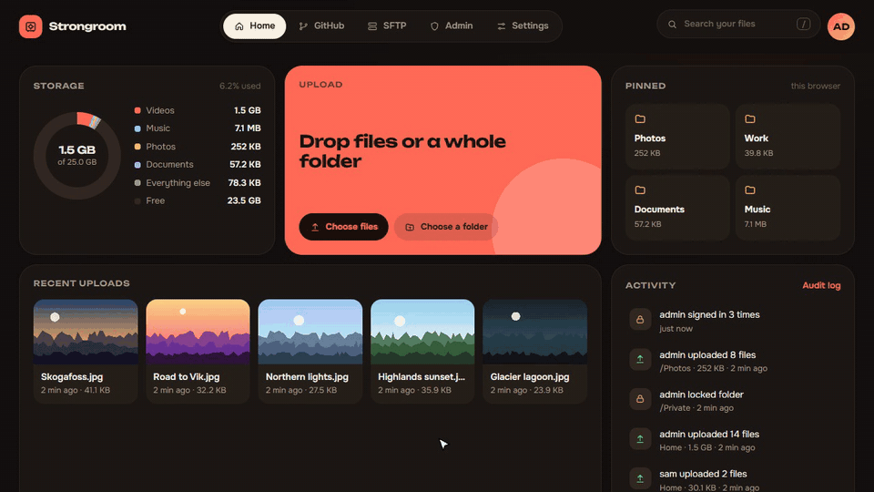
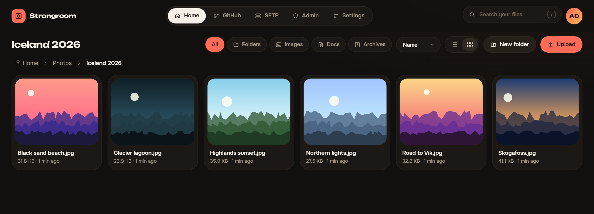
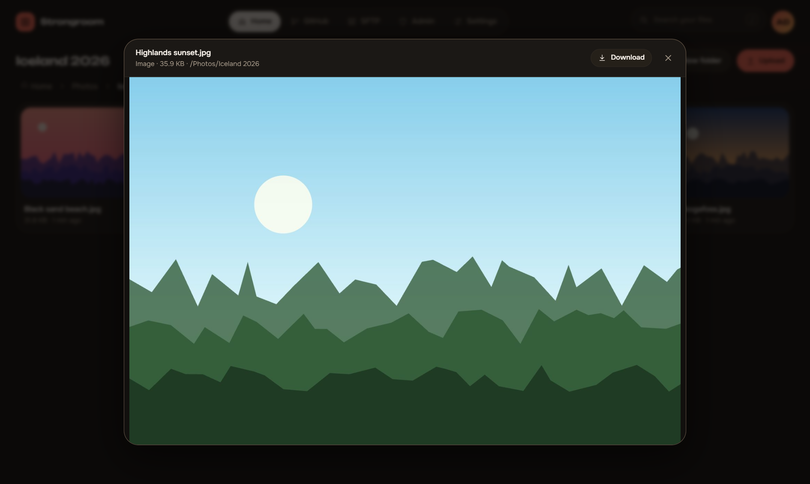
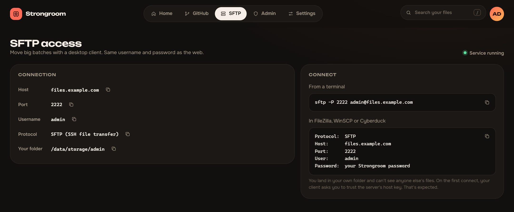

<div align="center">


# Strongroom

**Your own file cloud, on your own hardware.**

Upload, browse, preview and share files from any browser, sync them over SFTP,
and give everyone in your household or team their own account and quota.
One Node.js process and a SQLite file. No PHP stack, no external database.

[](https://github.com/Findiepman/Strongroom/actions/workflows/ci.yml)
[](https://github.com/Findiepman/Strongroom/releases)
[](https://github.com/Findiepman/Strongroom/pkgs/container/strongroom)
[](LICENSE)



</div>

## Features

- **Web file manager.** Drag and drop files or whole folders, with a progress
  tray. List or grid view with thumbnails, filters, sorting, search across all
  your folders, and in-browser preview for images, PDFs and text. Download any
  folder as a ZIP.
- **Dashboard.** Storage split per folder, pinned folders, recent uploads and
  recent activity at a glance.
- **Multiple accounts.** Admin and member roles, a storage quota per account,
  force sign-out, and an audit log of sign-ins, uploads, downloads and deletes.
- **SFTP built in.** Same login and the same folder as the web app, with the same
  upload checks and quota. Works with FileZilla, WinSCP, Cyberduck, `sftp`,
  and as a two-way sync target (see [rclone bisync on Windows](docs/rclone-bisync-windows.md)).
- **Locked folders.** Put a second password on any folder, on top of the sign-in.
- **GitHub puller.** Paste a public repository URL and the server clones it, or
  fast-forwards it on the next pull, with a live progress log.
- **Runs anywhere Node runs.** A Raspberry Pi, a mini PC, a VPS or a NAS-backed
  server. Files are plain files on disk, so your existing backup tools just work.

## Screenshots

<table>
  <tr>
    <td width="50%"><br><sub><b>Dashboard</b>: storage, pinned folders, recent uploads, activity</sub></td>
    <td width="50%"><br><sub><b>File browser</b>: grid or list view, filters and sorting</sub></td>
  </tr>
  <tr>
    <td><br><sub><b>Preview</b>: images, PDFs and text open in the browser</sub></td>
    <td><br><sub><b>Admin</b>: accounts, quotas and the audit log</sub></td>
  </tr>
  <tr>
    <td><br><sub><b>SFTP</b>: connection details for desktop clients</sub></td>
    <td><br><sub><b>Locked folders</b>: a second password per folder</sub></td>
  </tr>
</table>

## Quick start (Docker)

```bash
mkdir strongroom && cd strongroom
curl -O https://raw.githubusercontent.com/Findiepman/Strongroom/main/docker-compose.yml
docker compose up -d
docker compose logs strongroom | grep Password
```

Open <http://localhost:8080> and sign in as `admin` with the password from the
logs. Change it under **Settings**. That's it: files, accounts and keys are kept
in the `strongroom-data` volume and survive updates.

- **Keep files on a specific disk:** in `docker-compose.yml`, replace
  `strongroom-data:/data` with a host folder such as `/mnt/storage/strongroom:/data`.
  The container fixes the folder's ownership on start.
- **Opening it from another device:** sign-in cookies are HTTPS-only, so plain
  `http://192.168.x.x:8080` won't keep you signed in. Put it behind HTTPS (see
  [Access from anywhere](#access-from-anywhere)), or set `COOKIE_SECURE: "false"`
  in the compose file for a quick test on your own network.
- **SFTP** listens on port 2222: `sftp -P 2222 admin@<server>`.
- **Update:** `docker compose pull && docker compose up -d`.

The image is published for `linux/amd64` and `linux/arm64` (Raspberry Pi 4/5).
To build it yourself: `docker build -t ghcr.io/findiepman/strongroom .`

## Install without Docker

Requires Node.js 20+ and `git` (for the GitHub puller). Linux is recommended for
production; Windows and macOS work for development.

```bash
git clone https://github.com/Findiepman/Strongroom.git && cd Strongroom
npm install
npm start
```

Without a `.env` file Strongroom runs entirely out of `./data/` and generates its
own session secret. On first start it creates the admin account and prints a
random password **once**. For a real install, copy `.env.example` to `.env`,
set `NODE_ENV=production` and a `JWT_SECRET`:

```bash
node -e "console.log(require('crypto').randomBytes(48).toString('base64url'))"
```

To run it as a service, see [systemd](#running-as-a-service-systemd) below.

## Configuration

All settings are environment variables, read from `.env` or from the
`environment:` block in `docker-compose.yml`.

| Variable | Default | Meaning |
|---|---|---|
| `PORT` | `8080` | Web UI / API port |
| `HOST` | `0.0.0.0` | Bind address |
| `JWT_SECRET` | auto-generated | Session signing key. **Required** when `NODE_ENV=production`; otherwise generated once and stored in `DATA_DIR` |
| `SESSION_TTL_HOURS` | `12` | Server-side session lifetime |
| `COOKIE_SECURE` | `true` | Keep `true`. Browsers accept Secure cookies on `http://localhost` |
| `DATA_DIR` | `./data` (`/data` in Docker) | SQLite database, SSH host key, temp uploads, logs |
| `STORAGE_ROOT` | `DATA_DIR/storage` | File storage; one subfolder per user |
| `REPOS_ROOT` | `DATA_DIR/repos` | Where pulled GitHub repos live |
| `TMP_DIR` | `DATA_DIR/tmp` | Upload staging. Keep it on the same disk as `STORAGE_ROOT` |
| `ADMIN_USERNAME` | `admin` | Bootstrap admin name (first run only) |
| `ADMIN_PASSWORD` | random | Bootstrap admin password (first run only) |
| `MAX_UPLOAD_BYTES` | `2147483648` | Per-file upload cap (2 GiB) |
| `DEFAULT_QUOTA_BYTES` | `10737418240` | Quota for new accounts (10 GiB) unless the admin sets one |
| `SFTP_ENABLED` | `true` | Turn the SFTP service on or off |
| `SFTP_PORT` | `2222` | SFTP listen port |
| `SFTP_HOST` | same as `HOST` | Bind address for SFTP only. Lets the web app hide on `127.0.0.1` behind a tunnel while SFTP stays reachable |
| `SFTP_PUBLIC_HOST` | request host | Hostname shown on the SFTP page |
| `SFTP_ROOT` | `DATA_DIR/sftp` | No longer used; SFTP serves `STORAGE_ROOT/<user>` (see [Upgrading](#upgrading-sftp-now-shares-web-storage)) |
| `GIT_ALLOW_ANY_HTTPS_HOST` | `false` | `true` allows any https git host, not just github.com |
| `GIT_TIMEOUT_SECONDS` | `300` | Kill a clone or pull after this long |
| `TRUST_PROXY` | `false` | Set `true` behind nginx, Caddy or Cloudflare Tunnel so rate limits see real IPs |

## Access from anywhere

Secure cookies need HTTPS for any host other than localhost. Two common setups:

### Cloudflare Tunnel (no open ports)

The `cloudflared` daemon on your server dials out to Cloudflare, which routes
your hostname to `localhost:8080` over HTTPS. Nothing is opened on your router.

For a quick test, no account needed (the URL changes every run):

```bash
cloudflared tunnel --url http://localhost:8080
```

<details>
<summary><b>Permanent tunnel with your own hostname</b></summary>

You need a free Cloudflare account with a domain on it.

**1. Install cloudflared**

```bash
# Debian/Ubuntu
curl -L https://pkg.cloudflare.com/cloudflared-stable-linux-amd64.deb -o cloudflared.deb
sudo dpkg -i cloudflared.deb

# Windows
winget install Cloudflare.cloudflared
```

**2. Sign in and create the tunnel**

```bash
cloudflared tunnel login                                # opens a browser, pick your domain
cloudflared tunnel create strongroom                    # prints the tunnel id
cloudflared tunnel route dns strongroom files.example.com
```

**3. Configure it** in `~/.cloudflared/config.yml` (Windows:
`C:\Users\<you>\.cloudflared\config.yml`):

```yaml
tunnel: strongroom
credentials-file: /home/<you>/.cloudflared/<tunnel-id>.json

ingress:
  - hostname: files.example.com
    service: http://localhost:8080
  - service: http_status:404
```

**4. Point Strongroom at it** in `.env`:

```
NODE_ENV=production
JWT_SECRET=<generate one>
TRUST_PROXY=true
HOST=127.0.0.1        # web app is only reachable through the tunnel
SFTP_HOST=0.0.0.0     # keep SFTP reachable directly (see below)
```

With Docker, set `TRUST_PROXY: "true"` and publish the web port on localhost
only: `"127.0.0.1:8080:8080"`.

**5. Run it**

```bash
cloudflared tunnel run strongroom     # foreground, good for a first test
sudo cloudflared service install      # then install it as a service (works on Windows too)
```

**SFTP and the tunnel.** The tunnel carries HTTP only. For SFTP, pick one:

- **Port forward** TCP 2222 on your router. SFTP is already encrypted.
- **Tailscale** on the server and your devices; connect to the Tailscale IP.
  Nothing is exposed publicly.
- **Through Cloudflare anyway:** add a hostname with `service: ssh://localhost:2222`,
  then each client runs `cloudflared access tcp --hostname sftp.example.com --url localhost:2222`.

Do not host the frontend separately (for example on GitHub Pages). The server
serves the whole UI, and the SameSite=Strict cookie won't cross sites anyway.

</details>

### Reverse proxy (nginx, Caddy)

<details>
<summary><b>nginx example</b></summary>

```nginx
server {
    listen 443 ssl;
    server_name files.example.com;
    # ... ssl_certificate lines ...
    client_max_body_size 2g;        # match MAX_UPLOAD_BYTES
    location / {
        proxy_pass http://127.0.0.1:8080;
        proxy_set_header X-Forwarded-For $proxy_add_x_forwarded_for;
        proxy_set_header Host $host;
        proxy_http_version 1.1;
        proxy_buffering off;        # keeps the GitHub puller's live log streaming
        proxy_read_timeout 1h;      # long uploads and downloads
    }
}
```

Set `TRUST_PROXY=true` and `HOST=127.0.0.1`. SFTP is its own protocol: expose
port 2222 directly or through your firewall, not through nginx.

With Caddy it is one line: `files.example.com { reverse_proxy 127.0.0.1:8080 }`.

</details>

## Backups and restore

Everything Strongroom knows lives in two places:

- **`DATA_DIR`**: the SQLite database (`strongroom.db`, accounts, sessions,
  audit log, folder locks), the SSH host key and the session secret.
- **Your files**: `STORAGE_ROOT` and `REPOS_ROOT` (by default inside `DATA_DIR`).
  These are ordinary files and folders, so any tool works: rsync, restic,
  Borg, Synology Hyper Backup.

Back up with Strongroom stopped so the database is consistent. With Docker the
volume name starts with the folder the compose file is in (here `strongroom`):

```bash
# Docker (named volume)
docker compose stop
docker run --rm -v strongroom_strongroom-data:/data -v "$PWD":/backup alpine \
  tar czf /backup/strongroom-$(date +%F).tar.gz -C /data .
docker compose start

# Without Docker
sudo systemctl stop strongroom
tar czf strongroom-$(date +%F).tar.gz -C /srv/web data storage repos
sudo systemctl start strongroom
```

To restore, stop Strongroom, put the folders back in the same place, and start
it again. Quotas are recomputed from disk at the next sign-in.

## Security

Strongroom stores personal files, so the defaults are strict:

- Sessions are an httpOnly, Secure, SameSite=Strict cookie holding a JWT that
  points at a server-side session row. Sign-out, force sign-out and password
  changes delete the row, so the token dies server-side. Nothing auth-related
  is stored in localStorage.
- Passwords are hashed with bcrypt (cost 12). Sign-in and password endpoints
  are rate limited, with a global limiter on the whole API.
- CSRF: state-changing requests need a session-bound token header, on top of
  SameSite=Strict.
- Every client path is resolved server-side and checked to stay inside the
  user's own folder before any disk operation. SFTP uses the same jail.
- Uploads are content-checked server-side: executables (PE/ELF/Mach-O) are
  refused, and files claiming to be an image or PDF must actually be one.
  Previews are served with a strict CSP and `nosniff`; anything text-like is
  forced to `text/plain`, so uploaded HTML or SVG never runs in the app's origin.
- Admin pages and `/api/admin/*` check the role server-side on every request.
- The GitHub puller runs `git` with an argument list (no shell), accepts only
  `https://github.com/owner/repo` URLs, keeps clones inside `REPOS_ROOT`, and
  never forwards raw git output to the browser.

**Files are not encrypted at rest.** Anyone with access to the disk or NAS
share can read them. Use full-disk encryption if that matters for your setup.

Found a vulnerability? Please report it privately, see [SECURITY.md](SECURITY.md).

## Locked folders

Any folder can get its own password (⋯ menu → **Lock with password…**).

- Everything inside (listing, preview, download, ZIP, search, recent uploads,
  upload, rename, delete) needs the folder opened with its password first. An
  opened folder stays open for that browser session until 15 minutes pass
  without using it, until **Lock now**, or until you sign out.
- 10 wrong folder passwords in 15 minutes block further tries for 15 minutes.
  Every open, wrong password, lock and removal is in the audit log.
- Over SFTP, locked folders are hidden and refused (SFTP can't ask for a second
  password). A folder that holds a locked folder can't be renamed over SFTP.
- The lock belongs to the folder's path. Deleting a locked folder keeps the
  lock, so a backup or sync that puts it back finds it locked. For the same
  reason a locked folder (or one holding one) can't be renamed: remove the lock first.
- The lock protects the web app and SFTP; it does not encrypt the files.
- **Forgot a folder password?** On the server, in the Strongroom folder
  (with Docker, put `docker compose exec -u node strongroom` in front):

  ```
  node scripts/folder-locks.js list
  node scripts/folder-locks.js remove <username> /folder/path
  ```

## Running on a server

<details>
<summary><b>Running as a service (systemd)</b></summary>

```ini
# /etc/systemd/system/strongroom.service
[Unit]
Description=Strongroom file server
After=network.target

[Service]
User=strongroom
WorkingDirectory=/opt/strongroom
EnvironmentFile=/opt/strongroom/.env
ExecStart=/usr/bin/node server.js
Restart=on-failure
NoNewPrivileges=true
ProtectSystem=strict
ReadWritePaths=/srv/web

[Install]
WantedBy=multi-user.target
```

```bash
sudo systemctl enable --now strongroom
```

To update: `git pull && npm ci --omit=dev && sudo systemctl restart strongroom`.

</details>

<details>
<summary><b>Mounting a dedicated drive as the storage root</b></summary>

Assuming the drive shows up as `/dev/sdb` (check with `lsblk`):

```bash
# 1. Partition and format (DESTROYS whatever is on the disk)
sudo parted /dev/sdb --script mklabel gpt mkpart primary ext4 0% 100%
sudo mkfs.ext4 -L strongroom /dev/sdb1

# 2. Create the mount point and mount it
sudo mkdir -p /srv/web
sudo mount /dev/sdb1 /srv/web

# 3. Make the mount survive reboots (use the UUID, not the device name)
sudo blkid /dev/sdb1        # copy the UUID
echo 'UUID=<uuid-here>  /srv/web  ext4  defaults,noatime  0 2' | sudo tee -a /etc/fstab
sudo systemctl daemon-reload && sudo mount -a   # verify fstab is valid

# 4. Create the directory layout and hand it to the service user
sudo mkdir -p /srv/web/{storage,repos,data}
sudo useradd --system --home /srv/web --shell /usr/sbin/nologin strongroom
sudo chown -R strongroom:strongroom /srv/web
sudo chmod 750 /srv/web
```

Then in `.env`:

```
STORAGE_ROOT=/srv/web/storage
REPOS_ROOT=/srv/web/repos
DATA_DIR=/srv/web/data
NODE_ENV=production
```

Keep `DATA_DIR` on the same filesystem: uploads stream to a temp file and are
moved into place with a rename, which is only atomic on the same disk.

</details>

<details>
<summary><b>Storing files on a NAS (NFS)</b></summary>

The server keeps running Strongroom; the NAS only holds the files. Keep
`DATA_DIR` (the SQLite database) on the server's own disk: SQLite over NFS
risks corrupted locks. Everything else goes on the NAS.

On the NAS (Synology DSM): create a shared folder `strongroom`, turn on NFS
(Control Panel → File Services → NFS, max protocol NFSv4.1), then on the shared
folder add an NFS rule for the server's IP only: read/write, squash
"Map all users to admin", security `sys`, async on.

On the server:

```bash
sudo apt install nfs-common
sudo mkdir -p /srv/nas
echo '<nas-ip>:/volume1/strongroom  /srv/nas  nfs4  rw,hard,noatime,_netdev  0 0' | sudo tee -a /etc/fstab
sudo systemctl daemon-reload && sudo mount /srv/nas
sudo mkdir -p /srv/nas/{storage,repos,tmp}
```

`.env`:

```
STORAGE_ROOT=/srv/nas/storage
REPOS_ROOT=/srv/nas/repos
TMP_DIR=/srv/nas/tmp       # same disk as storage, so uploads land atomically
DATA_DIR=/home/<you>/strongroom-data   # stays local
```

Make the service wait for the mount, so a NAS that's down never makes
Strongroom quietly write to an empty local folder instead. Add this override
with `sudo systemctl edit strongroom`:

```ini
[Unit]
RequiresMountsFor=/srv/nas
```

Move existing files over with the service stopped:
`sudo rsync -a --info=progress2 <old STORAGE_ROOT>/ /srv/nas/storage/` (same
for repos), update `.env`, then start Strongroom again.

</details>

## Notes

- Deleting a user removes the account and its sessions but leaves their files
  on disk, so a mistaken click loses no data. Clean up `STORAGE_ROOT/<name>` by hand.
- SFTP and the web app share one folder per user, so the quota covers both.
  SFTP uploads are staged in `TMP_DIR` and only land on a good close, after the
  same content check as web uploads; a refused file comes back to the client as
  a failure with the reason and is logged as `upload.blocked`. SFTP upload,
  rename, mkdir and delete are audited. `/repos` is not part of SFTP. The quota
  is recomputed from disk at sign-in and on the Settings page.
- The SSH host key is generated on first run at `DATA_DIR/ssh_host_rsa_key`.
  Clients ask to trust it on first connect.

## Upgrading: SFTP now shares web storage

Older versions kept SFTP files in a separate tree, `SFTP_ROOT/<user>`. SFTP
now serves `STORAGE_ROOT/<user>` instead, so anything still in the old tree
is no longer visible over SFTP. To keep it, stop Strongroom and move it into
the web folder by hand, checking for name clashes first, e.g.
`sudo rsync -a --ignore-existing <SFTP_ROOT>/<user>/ <STORAGE_ROOT>/<user>/`,
then start Strongroom again (the quota is recomputed at the next sign-in).
Nothing is moved or deleted automatically. A top-level `repos` folder in the
old tree would not be reachable afterwards (the name is reserved), so rename
it first.

## Development

```bash
npm install
npm run dev     # restarts on file changes
npm test        # Node's built-in test runner
```

The stack is Node.js with Express, SQLite (better-sqlite3), bcrypt, ssh2 and
plain HTML, CSS and JavaScript: there is no frontend build step. The SFTP tests
start a real SFTP server on a random local port against a throwaway temp
folder, so they never touch your data.

Issues and pull requests are welcome. For anything larger than a fix, open an
issue first so we can agree on the approach.

## License

[MIT](LICENSE)
